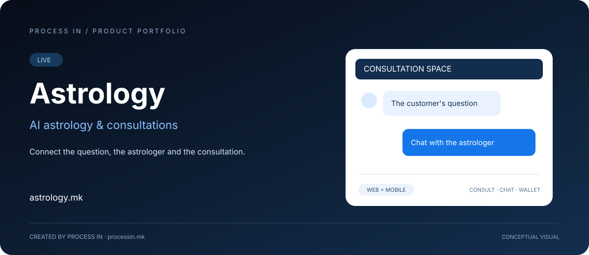

# Astrology

### Connect the question, the astrologer and the consultation.

**Lidhni pyetjen, astrologun dhe konsultimin.**

[Македонски](README.mk.md) · [English](README.md) · [Shqip](README.sq.md) · [Türkçe](README.tr.md)

**LIVE**

---

## Problemi dhe zgjidhja

Konsultimi astrologjik përfshin klientin që kërkon bisedë, praktikuesin që e ofron dhe kontekstin e llogarisë e pagesës. Përvoja duhet të lidhë hyrjen e klientit me vetë konsultimin.

Astrology.mk është platforma e PROCESS IN për astrologji AI dhe konsultime. Fushëveprimi i konfirmuar përfshin faqe klientësh, aplikacione Android e iOS, menaxhim astrologësh, bisedë të paguar në kohë reale, pagesa me portofol, shërbime shpirtërore dhe dyqan shpirtëror.

## Kujt i ndihmon

| Përdoruesit | Përdorimi |
|---|---|
| **Klientët** | Shqyrtojnë konsultime përmes web-it ose celularit. |
| **Astrologët** | Marrin pjesë si praktikues në konsultime. |
| **Operatorët** | Menaxhojnë astrologët, përmbajtjen dhe ofertën. |

## Çfarë bashkon produkti

### Faqja e klientit

Pikë hyrëse për platformën dhe konsultimet.

### Android dhe iOS

Aplikacionet japin kanal shtesë për klientët.

### Menaxhimi i astrologëve

Përfshin menaxhimin e praktikuesve që ofrojnë konsultime.

### Biseda e paguar në kohë reale

Konsultimi klient–astrolog përfshin rrjedhë bisede të paguar.

### Pagesat me portofol

Fushëveprimi tregtar përfshin pagesa përmes portofolit.

### Shërbimet dhe dyqani shpirtëror

Oferta e konfirmuar përfshin puja në tempuj dhe dyqan shpirtëror.

## Qasje praktike përdorimi

| Hapi | Veprimi |
|---|---|
| 01 | Shqyrtoni konsultimet në platformën zyrtare |
| 02 | Lexoni informacionin për praktikuesin dhe shërbimin |
| 03 | Ndiqni udhëzimet për llogarinë dhe konsultimin e paguar |
| 04 | Përdorni kanalin e konsultimit dhe shërbimet përkatëse |

## Skenarë praktikë

### Konsultim nga telefoni

Klienti përdor kanalin celular si pikënisje për shqyrtimin e platformës dhe ndjekjen e procesit.

### Bisedë me praktikuesin

Astrologu dhe klienti takohen në bisedë në kohë reale, me pagesën përmes rrjedhës së disponueshme të llogarisë.

## Pse ta shqyrtoni

Vlera është vazhdimësia nga zbulimi te konsultimi. Faqja dhe aplikacionet japin qasje; menaxhimi i astrologëve kontekstin e praktikuesit; biseda dhe portofoli lidhin përvojën me pagesën. Shërbimet dhe dyqani e zgjerojnë ofertën pa shpikur shërbime, çmime ose rezultate të premtuara.

## Informacion për produktin

| Hollësia | Vlera |
|---|---|
| Produkti | Astrology |
| Domeni zyrtar | [astrology.mk](https://astrology.mk/) |
| Statusi | LIVE |
| Zhvilluesi | [PROCESS IN](https://processin.mk) |
| Kategoria | AI astrology & consultations |
| Portofoli | [PROCESS IN](https://github.com/stambolce/process-in) |
| Kontakti tregtar | [contact@processin.mk](mailto:contact@processin.mk) |

Fushëveprimi bazohet në informacionin e konfirmuar të PROCESS IN. Ilustrimi është konceptual, jo pamje e aplikacionit.

### [Shqyrtoni Astrology →](https://astrology.mk/)

---

Prezantim publik. Pa kod privat, të dhëna klientësh ose sekrete qasjeje.

---

This platform is a digital product of <a href="https://processin.mk" target="_blank">PROCESS IN</a> · Your Enterprise Software & AI Partner ·  
Hosted on Enterprise Infrastructure by <a href="https://inhost.mk" target="_blank">INHOST</a> ·
